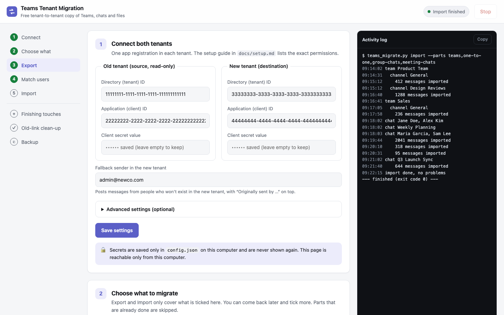
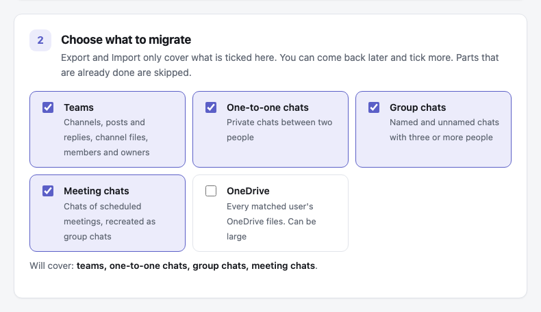
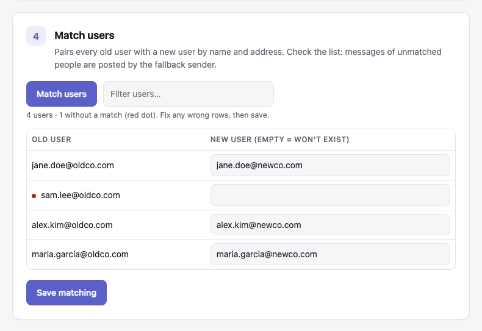
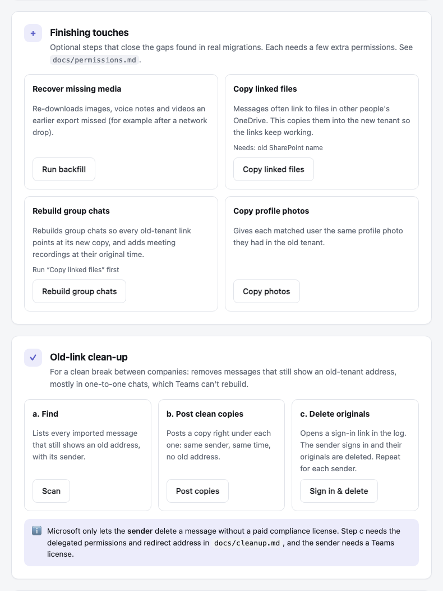
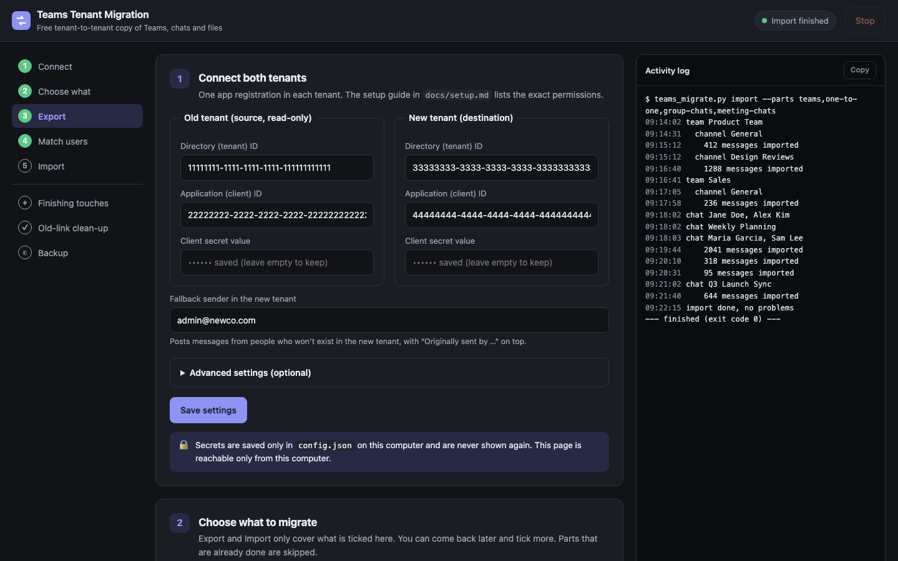
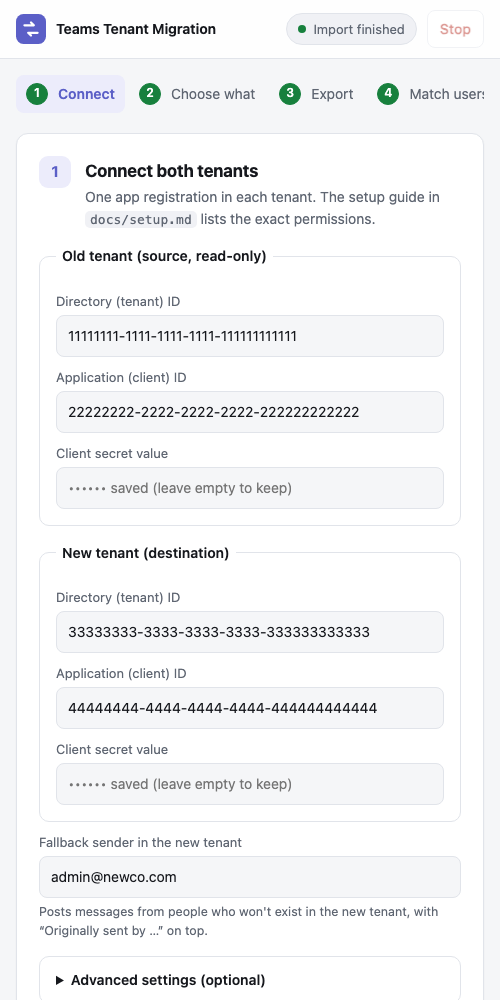

<div align="center">

# Teams Tenant Migration

**Free, open-source tenant-to-tenant migration for Microsoft Teams.**
Teams, channels, one-to-one and group chats, files and OneDrive move to a new Microsoft 365 tenant as *real* Teams messages, with the original sender and the original date.




</div>

---

## Why this exists

Commercial Teams migration tools are expensive. Microsoft's own Graph API can do most of the work for free through **Teams migration mode**, but it is full of undocumented limits and surprises. This project wraps that API in a tool that is safe to re-run, and records every lesson learned from a real company migration (see [`docs/lessons-learned.md`](docs/lessons-learned.md)).

- **No cost.** It only uses Microsoft Graph APIs included in your existing licenses.
- **No installs.** Plain Python 3.8+ standard library. Docker is optional.
- **Runs on your computer.** Your data goes straight from Microsoft to your machine and back, and nothing is sent anywhere else.
- **Safe to stop and restart.** Progress is saved after every item, so nothing is duplicated.
- **Migrate only what you need.** Choose any mix of teams, one-to-one chats, group chats, meeting chats and OneDrive, and add more later.

## What it migrates

| Item | Result in the new tenant |
|---|---|
| Teams, standard / private / shared channels, descriptions, settings | Recreated |
| Channel posts and replies, one-to-one chats, group chats | Real messages with the original sender and date |
| @mentions, inline images, reactions, subjects, importance, quoted replies | Kept |
| Voice notes, videos, large images | Uploaded to OneDrive and linked in the message |
| Channel files (SharePoint) | Same folders, original created/modified dates |
| OneDrive (optional) | Copied, including "Microsoft Teams Chat Files" |
| Files that messages link to in *other people's* OneDrive | Copied, and the links point to the new copies |
| Meeting recordings | Added to the chat as a message at the original time |
| Profile photos | Copied |
| Members and owners | Added |
| Everything, including chats Teams can't import | A readable HTML backup |

Some things **cannot** be made identical, for example the date shown in the chat list or "edited" marks. These are Microsoft limits; see [`docs/limitations.md`](docs/limitations.md).

## A look inside

<table>
<tr>
<td width="50%"><br><sub><b>Choose what to migrate.</b> Any mix of teams, chats and OneDrive, and add more later.</sub></td>
<td width="50%"><br><sub><b>Match users.</b> Automatic pairing that you can check and correct.</sub></td>
</tr>
<tr>
<td><br><sub><b>Finishing touches and clean-up.</b> Linked files, rebuilt group chats, photos, and a clean break between companies.</sub></td>
<td><br><sub><b>Dark mode</b> follows your system setting.</sub><br><br><br><sub><b>Works on small screens too.</b></sub></td>
</tr>
</table>

## Quick start

```bash
git clone https://github.com/anouby/teams-tenant-migration.git
cd teams-tenant-migration
python3 ui.py
```

Your browser opens **http://127.0.0.1:8765**. Then work down the page:

1. **Connect.** Paste the IDs and secrets of one app registration in each tenant. See [`docs/setup.md`](docs/setup.md).
2. **Choose what to migrate.** Any mix of teams, one-to-one chats, group chats, meeting chats and OneDrive.
3. **Export.** Reads your choice from the old tenant into the local `export/` folder.
4. **Match users.** Pairs each old user with a new user. Check and fix the list.
5. **Import.** Recreates it in the new tenant. Try one small team first.
6. **Finishing touches** (optional). Copy linked files, rebuild group chats with clean links, copy photos.
7. **Old-link clean-up** (optional). For a complete break between the two companies.

Prefer the command line? Every step is a command. See [`docs/commands.md`](docs/commands.md).

```bash
python3 teams_migrate.py export --parts teams,one-to-one,group-chats,onedrive
python3 teams_migrate.py map
python3 teams_migrate.py import --team "Small Test Team"
python3 teams_migrate.py import
```

### Docker

```bash
docker build -t teams-tenant-migration .
```
```bash
docker run --rm -p 127.0.0.1:8765:8765 -p 127.0.0.1:8799:8799 -v "$PWD":/app/data teams-tenant-migration
```

`config.json` and `export/` are kept in the current folder. Keep the `127.0.0.1:` prefix so that other computers on your network cannot open the page.

## Documentation

| Guide | What's inside |
|---|---|
| [Setup](docs/setup.md) | Preparing both tenants and the two app registrations, step by step |
| [Permissions](docs/permissions.md) | Exactly which permission each step needs, and why |
| [Commands](docs/commands.md) | Every command, its options, and when to use it |
| [How it works](docs/how-it-works.md) | Migration mode, progress journal, link rewriting, parallelism |
| [Limitations](docs/limitations.md) | What Microsoft does not allow, and the workarounds used |
| [Lessons learned](docs/lessons-learned.md) | Surprises from a real migration, so you don't hit them too |
| [Troubleshooting](docs/troubleshooting.md) | Error codes and what to do about each one |
| [Clean break and clean-up](docs/cleanup.md) | Removing old-tenant links, and removing all traces at the end |

## Typical timeline

| Phase | Time |
|---|---|
| App registrations and the protected-API request | 1 hour, plus a few days waiting for Microsoft's approval |
| Export | Minutes to hours, depending on file volume |
| Import | About 18,000 messages per hour per conversation. Many conversations run in parallel |
| Checks and finishing touches | A few hours |

## Security

- `config.json` holds app secrets and `export/` holds every message and file of the old tenant. Both are git-ignored. Keep them private and delete them when you are done.
- The browser interface only listens on `127.0.0.1` and refuses requests from other websites.
- At the end, delete both app registrations. See [`docs/cleanup.md`](docs/cleanup.md).

To report a vulnerability, see [SECURITY.md](SECURITY.md).

## Contributing

Bug reports, fixes and new features are welcome. See [CONTRIBUTING.md](CONTRIBUTING.md). The offline self-check needs no tenant:

```bash
python3 tests/test_teams_migrate.py
```

## Disclaimer

This project is not affiliated with Microsoft. Test it on a small team first, keep the old tenant until you have checked the result, and use it at your own risk. See the [LICENSE](LICENSE).
